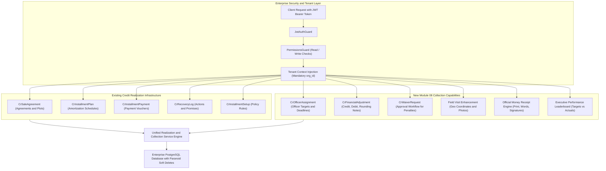

# Enterprise Architecture Plan: Credit Realization (CR) and Credit Collection Integration

## 1. Executive Summary and Architecture Goal

This specification provides the enterprise architecture for integrating the remaining features of Module 08 (Credit Collection) from the RealBiz Pro specification into our existing Credit Realization (CR) module. 

Our core architectural principle is strict backward compatibility. None of the existing database tables, API contracts, or frontend user interfaces will be broken or removed. All new capabilities are introduced as non breaking enhancements, optional columns, dedicated tables, and complementary routes that sit alongside our working Credit Realization infrastructure.

---

## 2. Security and Multi Tenant Isolation Architecture

### Mandatory Organization Scope
Every database table in the Credit Realization ecosystem must maintain a non optional `org_id VARCHAR(255)` column. All database queries must automatically filter by the tenant context extracted from the authenticated user token. Cross tenant data exposure is completely prevented at the data access layer.

### Role Based Access Control
Every HTTP route across the module is guarded with enterprise level NestJS guards:
1. `JwtAuthGuard`: Validates the bearer token signature, expiration, and user session.
2. `PermissionsGuard`: Enforces fine grained functional authorization.
3. `@Permissions(...)` Decorator:
   * Read Routes: `@Permissions('credit-realization:read')`
   * Write and Mutation Routes: `@Permissions('credit-realization:write')`
   * Approvals and Waivers: `@Permissions('credit-realization:approve')`

---

## 3. Database Schema Extensions

All new schemas run through standard migrations with default values, ensuring existing tables remain intact.

### 1. Officer Targets and Assignments (`cr_officer_assignments`)
Tracks specific collection quotas assigned to recovery and collection officers against property bookings.

* `id`: BIGINT PRIMARY KEY GENERATED ALWAYS AS IDENTITY
* `uuid`: UUID DEFAULT gen_random_uuid() UNIQUE NOT NULL
* `org_id`: VARCHAR(255) NOT NULL
* `officer_id`: VARCHAR(255) NOT NULL
* `officer_name`: VARCHAR(255) NOT NULL
* `sale_agreement_id`: BIGINT REFERENCES cr_sale_agreements(id) ON DELETE CASCADE
* `target_amount`: DECIMAL(14, 2) NOT NULL DEFAULT 0.00
* `collected_amount`: DECIMAL(14, 2) NOT NULL DEFAULT 0.00
* `due_date`: DATE NOT NULL
* `assignment_date`: DATE NOT NULL DEFAULT CURRENT_DATE
* `status`: VARCHAR(50) NOT NULL DEFAULT 'assigned' (assigned, in_progress, achieved, overdue)
* `notes`: TEXT NULL
* `created_by`: VARCHAR(255) NULL
* `updated_by`: VARCHAR(255) NULL
* `created_at`: TIMESTAMPTZ NOT NULL DEFAULT NOW()
* `updated_at`: TIMESTAMPTZ NOT NULL DEFAULT NOW()
* `deleted_at`: TIMESTAMPTZ NULL

### 2. Financial Adjustments (`cr_financial_adjustments`)
Handles formal ledger adjustments including credit notes, debit notes, and rounding write offs without tampering with historical payments.

* `id`: BIGINT PRIMARY KEY GENERATED ALWAYS AS IDENTITY
* `uuid`: UUID DEFAULT gen_random_uuid() UNIQUE NOT NULL
* `org_id`: VARCHAR(255) NOT NULL
* `sale_agreement_id`: BIGINT REFERENCES cr_sale_agreements(id) ON DELETE CASCADE
* `installment_plan_id`: BIGINT REFERENCES cr_installment_plans(id) ON DELETE SET NULL
* `adjustment_type`: VARCHAR(50) NOT NULL (credit_note, debit_note, rounding)
* `amount`: DECIMAL(14, 2) NOT NULL
* `reason`: TEXT NOT NULL
* `reference_no`: VARCHAR(100) NULL
* `approved_by`: VARCHAR(255) NULL
* `status`: VARCHAR(50) NOT NULL DEFAULT 'applied' (pending, applied, reversed)
* `created_by`: VARCHAR(255) NULL
* `updated_by`: VARCHAR(255) NULL
* `created_at`: TIMESTAMPTZ NOT NULL DEFAULT NOW()
* `updated_at`: TIMESTAMPTZ NOT NULL DEFAULT NOW()
* `deleted_at`: TIMESTAMPTZ NULL

### 3. Formal Waiver Requests (`cr_waiver_requests`)
Allows officers to submit delay penalty reduction requests with justification and attachment proofs for multi tier management approval.

* `id`: BIGINT PRIMARY KEY GENERATED ALWAYS AS IDENTITY
* `uuid`: UUID DEFAULT gen_random_uuid() UNIQUE NOT NULL
* `org_id`: VARCHAR(255) NOT NULL
* `sale_agreement_id`: BIGINT REFERENCES cr_sale_agreements(id) ON DELETE CASCADE
* `installment_plan_id`: BIGINT REFERENCES cr_installment_plans(id) ON DELETE CASCADE
* `requested_amount`: DECIMAL(14, 2) NOT NULL
* `approved_amount`: DECIMAL(14, 2) DEFAULT 0.00
* `reason`: TEXT NOT NULL
* `attachment_url`: VARCHAR(1000) NULL
* `approver_id`: VARCHAR(255) NULL
* `approver_name`: VARCHAR(255) NULL
* `approval_status`: VARCHAR(50) NOT NULL DEFAULT 'pending' (pending, approved, rejected)
* `approval_remarks`: TEXT NULL
* `actioned_at`: TIMESTAMPTZ NULL
* `created_by`: VARCHAR(255) NULL
* `updated_by`: VARCHAR(255) NULL
* `created_at`: TIMESTAMPTZ NOT NULL DEFAULT NOW()
* `updated_at`: TIMESTAMPTZ NOT NULL DEFAULT NOW()
* `deleted_at`: TIMESTAMPTZ NULL

### 4. Non Breaking Field Visit Extensions on `cr_recovery_logs`
We append non breaking columns to the existing `cr_recovery_logs` table to support rich physical customer visits:
* `geo_location`: VARCHAR(255) NULL (e.g. GPS latitude and longitude)
* `visit_photos`: TEXT NULL (JSON array of stored MinIO / S3 file keys)
* `visit_outcome`: VARCHAR(50) NULL (collected, promise, refused, not_home)

---

## 4. Backend Service and API Route Architecture

### Controller Summary in realbiz_pro_server

| Controller Class | Endpoint Route | Methods | Permission Guard |
| :--- | :--- | :--- | :--- |
| `CrAgreementController` | `/realbizpro/api/v1/credit-realization/agreements` | GET, POST, PUT, DELETE | `@Permissions('credit-realization:read/write')` |
| `CrInstallmentController` | `/realbizpro/api/v1/credit-realization/installments` | GET, POST | `@Permissions('credit-realization:read/write')` |
| `CrRecoveryController` | `/realbizpro/api/v1/credit-realization/recovery` | GET, POST, PUT, PATCH, DELETE | `@Permissions('credit-realization:read/write')` |
| `CrAssignmentController` (NEW) | `/realbizpro/api/v1/credit-realization/assignments` | GET, POST, PUT, DELETE | `@Permissions('credit-realization:read/write')` |
| `CrAdjustmentController` (NEW) | `/realbizpro/api/v1/credit-realization/adjustments` | GET, POST, PATCH | `@Permissions('credit-realization:read/write')` |
| `CrWaiverController` (NEW) | `/realbizpro/api/v1/credit-realization/waivers` | GET, POST, PATCH | `@Permissions('credit-realization:read/write/approve')` |
| `CrReportsController` | `/realbizpro/api/v1/credit-realization/reports` | GET | `@Permissions('credit-realization:read')` |
| `CrSetupController` | `/realbizpro/api/v1/credit-realization/setups` | GET, POST, PUT, DELETE | `@Permissions('credit-realization:read/write')` |

### New Reporting Endpoints Added to `CrReportsController`
1. `GET /realbizpro/api/v1/credit-realization/reports/officer-performance`
   Returns real time quotas, total recovered, collection percentage, and comparative bar chart metrics per officer.
2. `GET /realbizpro/api/v1/credit-realization/reports/defaulters-leaderboard`
   Calculates top overdue delinquent accounts sorted by delay days and total outstanding balance.

---

## 5. Performance Optimization Strategy

1. **High Selectivity Compound Indexes**:
   * `idx_cr_inst_plans_tenant_status`: `(org_id, due_date, status)`
   * `idx_cr_recoveries_tenant_action`: `(org_id, action_type, action_date)`
   * `idx_cr_assign_tenant_officer`: `(org_id, officer_id, due_date)`
   * `idx_cr_payments_tenant_voucher`: `(org_id, payment_voucher_no)`
2. **Transaction Isolation and Concurrency Guards**:
   All collection payments and adjustment postings run inside PostgreSQL database transactions with row level locking (`SELECT ... FOR UPDATE`) on the target installment schedule to prevent duplicate voucher creation under concurrent requests.
3. **Optimized Pagination**:
   Large tables (Customer Dues, Overdue List, Recovery Logs) support structured pagination with limit, offset, and sanitized sorting to prevent unbounded in memory allocations.

---

## 6. Frontend Route and Component Enhancement Strategy

### Existing Routes Enhanced (Non Breaking)
1. [`/dashboard/cr/dashboard`](file:///home/sakib/Desktop/Projects%20Old/realbiz/realbiz_pro/src/app/(admin-dashbord)/dashboard/cr/dashboard/page.tsx):
   Add Officer Performance widgets and Top Defaulters leaderboard beside existing summary metrics.
2. [`/dashboard/cr/due`](file:///home/sakib/Desktop/Projects%20Old/realbiz/realbiz_pro/src/app/(admin-dashbord)/dashboard/cr/due/page.tsx):
   Add fast actions for Assign Officer and Quick Collection Entry directly from customer due rows.
3. [`/dashboard/cr/overdue-list`](file:///home/sakib/Desktop/Projects%20Old/realbiz/realbiz_pro/src/app/(admin-dashbord)/dashboard/cr/overdue-list/page.tsx):
   Connect formal multi tier waiver submissions and adjustment modals.
4. [`/dashboard/cr/visits`](file:///home/sakib/Desktop/Projects%20Old/realbiz/realbiz_pro/src/app/(admin-dashbord)/dashboard/cr/visits/page.tsx):
   Integrate photo evidence viewer and GPS coordinate badges on visit log rows.
5. [`/dashboard/cr/receipt-voucher`](file:///home/sakib/Desktop/Projects%20Old/realbiz/realbiz_pro/src/app/(admin-dashbord)/dashboard/cr/receipt-voucher/page.tsx):
   Add printable money receipt voucher modal complete with amount in words, company header, and signature stamps.

### Complementary Routes Added to CR Navigation
1. `/dashboard/cr/assignments`: Dedicated officer recovery assignment and quota tracking screen.
2. `/dashboard/cr/performance`: Dedicated collection performance and leaderboard analysis dashboard.
3. `/dashboard/cr/waivers`: Dedicated approval hub for penalty waiver requests.

---

## 7. Verification and Testing Plan

1. **Automated Unit and Integration Tests**:
   * Controller unit tests with mocked guards verifying `@Permissions` decorators.
   * Service tests verifying mathematical accuracy of penalty calculations, adjustments, and quotas.
   * Frontend unit tests verifying component rendering and route link resolution.
2. **Production Build Checks**:
   * Backend: `npm run build` (`nest build`) exits with code 0.
   * Frontend: `npm run build` (`next build --webpack`) exits with code 0.
3. **Browser Automation Testing**:
   * DevTools verification across all existing and newly connected routes.
