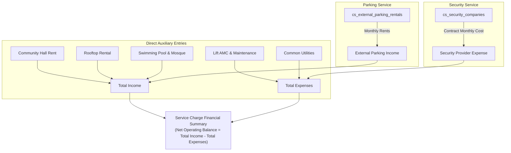

# RealBiz Pro — Customer Service Module Architecture & Integration Guide

## 1. Overview & Multi-Tenancy Architecture

The Customer Service module (`/dashboard/customer-service/*`) is a multi-tenant enterprise real estate post-sales and facility management system. It manages resident relations, utility claims, security operations, parking slot allocations and external rentals, building committees, service charge billing, and cross-module expense/income aggregations.

### Strict Multi-Tenancy Rules (Non-Negotiable)
1. **Server-Derived Tenancy**:
   - `organization_id` is **NEVER** accepted from client request bodies, DTOs, query parameters, or route paths.
   - The backend internally extracts `orgId` via `extractUserContext(req, userModel)`. The helper inspects the JWT payload (`user.organization?.id` or `user.organization_id`) and falls back to a database lookup on `users.organization_id`.
   - **Payload Anti-Tampering**: NestJS global `ValidationPipe({ whitelist: true, forbidNonWhitelisted: true })` automatically rejects any client request containing `organization_id` with `HTTP 400 Bad Request` (`property organization_id should not exist`).
2. **Project Scoping & Anti-Tampering**:
   - Every record is tied to a `project_id` (UUID).
   - The user selects an active project from the persistent top-bar selector (`CSProjectSelector.tsx`), stored in `localStorage` under `realbiz_cs_selected_project_id`.
   - The backend validates that any referenced `project_id` belongs to the authenticated tenant.
3. **Cross-Tenant Isolation (404 Rule)**:
   - All `findOne`, `update`, and `destroy` operations enforce `where: { id, organizationId: ctx.orgId }`.
   - Attempting to access, modify, or delete a record belonging to another organization strictly returns `HTTP 404 Not Found` (never leaking existence or data).
4. **Role Boundary Enforcement**:
   - **Super Admin**: Operates unconstrained across all tenant organizations and projects (`ctx.isSuperAdmin === true`).
   - **Regular Tenant User without Organization**: Rejected immediately with `HTTP 403 Forbidden` (`Tenant organization context is required`).

---

## 2. Workspace & Folder Structure

### Backend: `realbiz_pro_server` (`src/modules/customer-service/`)
```
src/modules/customer-service/
├── common/
│   └── customer-service-context.helper.ts    # extractUserContext & tenancy helper
├── dto/
│   ├── base-filter.dto.ts                    # Clean base pagination & search DTO
│   └── ...
├── bookings/
│   ├── dto/                                  # Properties & Handover DTOs
│   ├── customer-service-bookings.controller.ts
│   ├── customer-service-bookings.service.ts
│   └── *.spec.ts                             # Unit test suites
├── utility-service/
│   ├── dto/                                  # Claims, Technicians, Warranties DTOs
│   ├── utility-service.controller.ts
│   ├── utility-service.service.ts
│   └── utility-service.service.spec.ts
├── security-service/
│   ├── dto/                                  # Companies, Guards, Rosters, Visitors DTOs
│   ├── security-service.controller.ts
│   ├── security-service.service.ts
│   └── security-service.service.spec.ts
├── parking-service/
│   ├── dto/                                  # Slots, Assignments, External Rentals DTOs
│   ├── parking-service.controller.ts
│   ├── parking-service.service.ts
│   └── parking-service.service.spec.ts
├── service-charge/
│   ├── dto/                                  # Rates, Monthly Charges, Incomes, Expenses DTOs
│   ├── service-charge.controller.ts
│   ├── service-charge.service.ts
│   └── service-charge.service.spec.ts
├── building-committee/
│   ├── dto/                                  # Members, Roles, Decisions DTOs
│   ├── building-committee.controller.ts
│   ├── building-committee.service.ts
│   └── building-committee.service.spec.ts
├── change-requests/
├── customer-service.module.ts                # Main DI orchestrator
├── customer-service.controller.ts
└── customer-service.service.ts
```

### Database Models (`src/database/models/customer-service/`)
- `cs_customer_profile.model.ts` (`cs_customer_profiles`)
- `cs_booking_handover.model.ts` (`cs_booking_handovers`)
- `cs_utility_claim.model.ts` (`cs_utility_claims`)
- `cs_technician.model.ts` (`cs_technicians`)
- `cs_warranty_item.model.ts` (`cs_warranty_items`)
- `cs_security_company.model.ts` (`cs_security_companies`)
- `cs_security_guard.model.ts` (`cs_security_guards`)
- `cs_duty_roster.model.ts` (`cs_duty_rosters`)
- `cs_visitor_log.model.ts` (`cs_visitor_logs`)
- `cs_parking_slot.model.ts` (`cs_parking_slots`)
- `cs_parking_assignment.model.ts` (`cs_parking_assignments`)
- `cs_external_parking_rental.model.ts` (`cs_external_parking_rentals`)
- `cs_service_charge_rate.model.ts` (`cs_service_charge_rates`)
- `cs_service_charge_bill.model.ts` (`cs_service_charge_bills`)
- `cs_income_entry.model.ts` (`cs_income_entries`)
- `cs_expense_entry.model.ts` (`cs_expense_entries`)
- `cs_committee_member.model.ts` (`cs_committee_members`)
- `cs_committee_meeting.model.ts` (`cs_committee_meetings`)

### Frontend: `realbiz_pro_frontend` (`src/app/(admin-dashbord)/dashboard/customer-service/`)
```
src/app/(admin-dashbord)/dashboard/customer-service/
├── layout.tsx                                # Injects CSProjectSelector & context
├── page.tsx                                  # Module landing dashboard
├── utility-service/page.tsx                  # Claims, Technicians, Warranties
├── security-service/page.tsx                 # Guards, Companies, Weekly Roster, Visitors
├── parking-service/page.tsx                  # Status-colored grid, Assignments, Rentals, Income
├── service-charge/page.tsx                   # Charges, Other Incomes, Expenses, Monthly Summary
├── building-committee/page.tsx               # Committee Members, Office Bearers, Meeting Logs
├── other-services/page.tsx                   # Facility bookings, pest control, waste management
└── customers/
    ├── page.tsx                              # Customer Entry (re-exports Customer 360)
    ├── customer-360/page.tsx                 # Comprehensive customer profile & history
    ├── properties-bookings/page.tsx          # Possession handovers, DLP tracking, snagging
    └── change-requests/page.tsx              # Unit modifications & architectural approvals
```

---

## 3. Complete Endpoint Reference Table

All endpoints are mounted under prefix `/realbizpro/api/v1/customer-service` and require `JwtAuthGuard`.

| Sub-Module | Method | Endpoint Path | Description |
|---|---|---|---|
| **Utility Service** | `GET` | `/utility/claims` | List claims with FIFO auto-sequencing |
| | `POST` | `/utility/claims` | Create claim with automated FREE/PAID warranty check |
| | `GET` | `/utility/claims/:id` | Get single claim detail |
| | `PUT` | `/utility/claims/:id/status` | Lifecycle update (`Open` $\to$ `Assigned` $\to$ `In Progress` $\to$ `Resolved` $\to$ `Closed`) |
| | `GET` | `/utility/technicians` | List internal/external technicians & specialties |
| | `POST` | `/utility/technicians` | Register new technician |
| | `GET` | `/utility/warranty-items` | Unit fixture warranty registry |
| | `POST` | `/utility/warranty-items` | Register new fixture warranty item |
| **Security Service** | `GET` | `/security/companies` | List contracted security agencies |
| | `POST` | `/security/companies` | Register security company contract |
| | `GET` | `/security/companies/expiring`| 30-day contract expiry alerts |
| | `GET` | `/security/guards` | List guards (In-House vs Company-Supplied) |
| | `POST` | `/security/guards` | Register guard (enforces `company_id` if source is `COMPANY`) |
| | `GET` | `/security/roster` | Weekly duty roster |
| | `POST` | `/security/roster` | Schedule duty shift (strictly rejects overlapping shifts) |
| | `GET` | `/security/visitors` | List active & past visitor logs |
| | `POST` | `/security/visitors` | Check-in visitor |
| | `PUT` | `/security/visitors/:id/checkout` | Check-out visitor |
| | `GET` | `/security/costs/monthly` | Aggregated monthly security contract cost |
| **Parking Service** | `GET` | `/parking/slots` | Slot inventory with status (`FREE`, `OCCUPIED`, `RENTED_EXTERNAL`) |
| | `POST` | `/parking/slots` | Create parking slot (unique slot number per project) |
| | `GET` | `/parking/assignments` | List resident slot assignments |
| | `POST` | `/parking/assignments` | Assign slot (rejects double assignment) |
| | `PUT` | `/parking/assignments/:id/release` | Release assigned slot |
| | `GET` | `/parking/rentals` | List external tenant parking rentals |
| | `POST` | `/parking/rentals` | Create external rental contract |
| | `GET` | `/parking/summary` | Monthly parking income summary (Collected vs Due) |
| **Service Charge** | `GET` | `/service-charge/rates` | Configured rates per flat type / sqft |
| | `POST` | `/service-charge/rates` | Set project service charge rate |
| | `GET` | `/service-charge/bills` | Monthly resident bills (Paid / Due / Partial) |
| | `POST` | `/service-charge/bills/generate` | Bulk generate monthly bills for all project units |
| | `GET` | `/service-charge/incomes` | Non-maintenance income (hall, rooftop, pool, mosque) |
| | `POST` | `/service-charge/incomes` | Record auxiliary income entry |
| | `GET` | `/service-charge/expenses` | Facility expenses (lift, cleaning, maintenance) |
| | `POST` | `/service-charge/expenses` | Record facility expense entry |
| | `GET` | `/service-charge/summary` | Consolidated P&L summary with cross-module feeds |
| **Building Committee** | `GET` | `/building-committee/members` | Roster of developer reps and flat owners |
| | `POST` | `/building-committee/members` | Register committee member & office bearer role |
| | `GET` | `/building-committee/meetings`| Committee meetings and decision log |
| | `POST` | `/building-committee/meetings`| Record meeting minutes & action items |
| **Bookings & Handover** | `GET` | `/bookings` | List booked units with handover lifecycle stage |
| | `GET` | `/bookings/:id/360` | Full booking handover 360 overview |
| | `PUT` | `/bookings/:id/handover-status` | Advance stage (`Under Construction` $\to$ `Snagging` $\to$ `DLP` $\to$ `Handed Over`) |
| | `GET` | `/bookings/:id/demand-preview` | Preview statutory possession & demand letters |

---

## 4. Cross-Module Feeds Architecture

The Service Charge Monthly Summary (`/customer-service/service-charge/summary`) acts as the central financial clearinghouse for post-sales facility management:



1. **External Parking Feed**: Automatically aggregates active external parking rentals (`status = 'ACTIVE'`) for the target project and adds monthly contract rents to `cross_module_feeds.parking.total_monthly_rent`.
2. **Security Contract Feed**: Queries all active security company contracts (`status = 'ACTIVE'`) where the current date falls between `contract_start_date` and `contract_end_date`. Aggregates monthly billings into `cross_module_feeds.security.total_monthly_cost`.
3. **DECIMAL Precision**: All financial calculations use PostgreSQL `DECIMAL(12, 2)` to eliminate floating-point rounding inaccuracies.

---

## 5. Ticket Lifecycle & Warranty Classification

When a resident submits a utility claim or maintenance request:
1. **Automated Warranty Evaluation**:
   - The system checks `cs_warranty_items` matching `project_id`, `unit`, and `item_name` / `category`.
   - If an active warranty item is found whose date range covers the ticket date, the claim is automatically classified as `cost_type = 'FREE'`, and `estimated_charge = 0.00`.
   - If no active warranty exists or the warranty has expired, the claim is auto-classified as `cost_type = 'PAID'`.
2. **FIFO Auto-Sequencing**:
   - Tickets are assigned sequential ticket numbers scoped per project (`UTL-PRJ-{YEAR}-{SERIAL}`).
3. **Sequential State Transitions**:
   - `OPEN`: Claim logged by resident or desk.
   - `ASSIGNED`: Linked to an active `cs_technicians` member.
   - `IN_PROGRESS`: Technician begins on-site diagnosis or repair.
   - `RESOLVED`: Rectification completed; pending resident signoff.
   - `CLOSED`: Resident acknowledges satisfaction and signs off.

---

## 6. Modules Under Review: Use-Case & Dependency Notes

> [!IMPORTANT]
> The following three sub-modules are under review pending final architectural direction from the meeting speaker. Per project directives, **they are preserved intact with zero deletions or merges**.

### A. Customer Entry (`/customers`) & Customer 360° (`/customers/customer-360`)
- **Primary Use Case**:
  Provides a post-sales, resident-centric view distinct from pre-sales leads. Focuses on flat owners, co-owners, resident tenants, KYC identity files, emergency contacts, open tickets, snagging defect history, and warranty statuses.
- **Key Dependencies**:
  - Model: `CsCustomerProfile` (`cs_customer_profiles`).
  - Cross-module relationships: Foreign keys to `pr_flat_land_booking` and CRM customer tables (`crm_leads` / `crm_customers`).
- **Review Question for Meeting**:
  *Should Customer 360 remain an independent sub-menu under Customer Service for building management, or should it be consolidated into a unified "Customer Master" in CRM with a specialized "Resident View" tab?*

### B. Bookings & Property Portfolio (`/customers/properties-bookings`)
- **Primary Use Case**:
  Manages physical property possession and statutory DLP (Defect Liability Period) lifecycles. Governs the post-construction handover gate, tracking snag list resolution, key issuance counters, possession certificates, and the statutory 2-year warranty clock.
- **Key Dependencies**:
  - Model: `CsBookingHandover` (`cs_booking_handovers`).
  - Foreign tables: `pr_flat_land_booking`, `pr_flatland`, `pr_project`, `pr_cr_sale_agreements`, `pr_cr_installment_plans`.
- **Review Question for Meeting**:
  *Does Credit Realisation (CR) retain financial clearance sign-off while Customer Service strictly executes physical snagging and key handover, or should the entire post-booking handover state machine be orchestrated from Customer Service?*

---

## 7. Verification & Test Suite Summary

- **Unit Test Coverage**: `src/modules/customer-service/`
  - 9 / 9 test suites passed.
  - 72 / 72 tests passed (100% success rate).
- **Live E2E Multi-Tenant Verification**: `scripts/test-cs-final-e2e.js`
  - 31 / 31 assertions passed against live PostgreSQL database.
  - Validated 2 orgs $\times$ 2 projects cross-tenant isolation (HTTP 404 on tampering).
  - Validated payload anti-tampering (HTTP 400 Bad Request if `organization_id` sent in body).
  - Validated Super Admin unconstrained access and non-super-admin 403 Forbidden blocking.
  - Validated warranty FREE vs PAID auto-classification and sequential ticket lifecycle.
  - Validated cross-module feeds (external parking income + security contracts into service charge summary).

